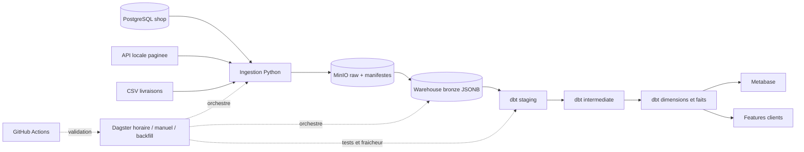

# Architecture et lineage

Le PostgreSQL source et le warehouse sont deux instances et volumes distincts.
La base technique de Metabase est une troisieme instance PostgreSQL ; elle ne
contient pas les commandes mais les utilisateurs, questions et dashboards BI.
Dagster conserve les runs et evenements dans un volume SQLite local.

## Grains

| Modele marts | Grain / cle |
|---|---|
| dim_customer | Une version observee de client ; customer_key SCD2 |
| dim_product | Un produit courant ; product_key |
| dim_date | Un jour UTC ; date_key YYYYMMDD |
| fact_orders | Une commande ; order_id |
| fact_order_items | Une ligne achetee ; order_item_id |
| fact_payments | Un paiement ; payment_id |
| daily_sales | Un jour de vente ; sales_date |
| product_sales | Un produit avec ventes payees |
| customer_features | Un client a la date as_of_date |

Les faits commandes referencent la version client valable a la date de commande,
avec `valid_from <= ordered_at < valid_to`, sauf pour la version courante ouverte.
La dimension client est reconstruite depuis toutes les revisions observees dans
raw ; cela conserve aussi les modifications survenues avant le premier dbt build.
Elle ne pretend pas retrouver des etats intermediaires jamais extraits de la source.
La dimension produit est de type 1 ; le prix historique achete reste sur les faits.

La documentation dbt genere le lineage exact des `source()` et `ref()` et le
catalogue. Elle est accessible sur http://localhost:8081 apres un run reussi.
L'API et le CSV aboutissent respectivement a stg_events (features clients) et
stg_shipping (donnees de livraison disponibles et testees).
